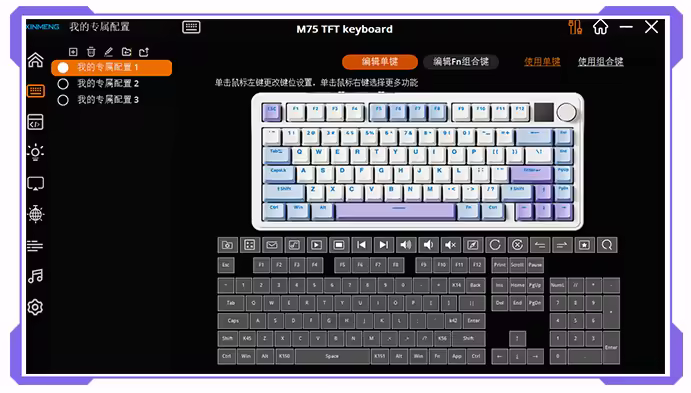

# Aurora

Aurora is a FOSS implementation of the protocol used by some random (Sonix) mechanical keyboards software.

If you're keyboard software looks like this:



Then this project is for you (hopefully).

## Why?

The original software is closed source and only available for Windows.
While I plan to eventually port [SonixQMK](https://github.com/SonixQMK) to my keyboard, I wanted to still change settings without relying on that half broken software.

## Features

- Supports both Wired and 2.4Ghz dongle connections.
- Keymap editor
- RGB lighting editor
- Dump and restore full regions
- Support for adding more keyboards

In theory, the following features can be implemented, but I don't have any device to test them on:
- Screen
- Firmware update?
- LEDs sync with music
- Battery status
- Maybe bluetooth transport?

## Supported Keyboards

Currently, the following keyboards are supported:

- Xinmeng/Surmen M75 (non PRO version), or equivalent boards using the same VID:PID (0x0C45:0x8006)

## Install

Compile the program with `cargo build --release`.

Install the [udev rules](packages/udev) in `/etc/udev/rules.d/` and run

```sh
$ sudo udevadm control --reload-rules && sudo udevadm trigger
```

Run the program with `./target/release/aurora`.

## How to use

Aurora offers a CLI to control your keyboard.

Some example commands:

```sh
# Set the default board to use from now on.
$ aurora config default_board <board_id>

# See general info about the current attached board
$ aurora info

# Show the current keyboard settings
$ aurora settings
# Disables windows key
$ aurora settings --win-dis true

# Dump all the keyboard settings to the 'region' folder
$ aurora dump regions
```

You can use `aurora --help` to see all available commands and `aurora <command> --help` to see the options for a specific command.

## Porting

If you want to add support for a new keyboard, you'll need to:

* Create a new board in the [boards](crates/aurora-boards/src) directory, following the structure of the existing boards.
* Find the VID:PID of your keyboard, capabilities etc, and fill the board definition. Usually, this info can be found in the original software in an XML file.
* Hope it works or open an issue if it doesn't.

## Resources

- [USB: Reverse Engineering and Writing Drivers](https://www.youtube.com/watch?v=is9wVOKeIjQ) - Reverse engineering of a Keyboard with a similar or probably the same protocol
- [More USB Reverse Engineering + Drivers](https://www.youtube.com/watch?v=7Zo3bdaqfbo&) - Part 2 of the video above
- [MCU datasheet](https://www.digchip.com/datasheets/parts/datasheet/2/805/SN32F248B.php) - Datasheet for the SN32F248B Cortex M0 MCU used in my keyboard
- [Keyboard firmware dumps](https://github.com/shomykohai/xinmeng-m75/) - Firmware update software for Xinmeng M75 and Xinmeng M75 Pro, with firmware dumps for both
- Probably more I forgot to add

## License

This project is licensed under the GNU General Public License v3 or later (GPL-3.0-or-later), see [LICENSE](LICENSE) for details.
